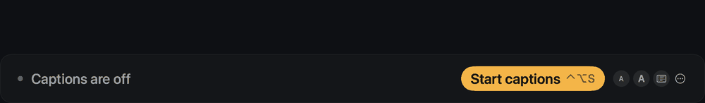
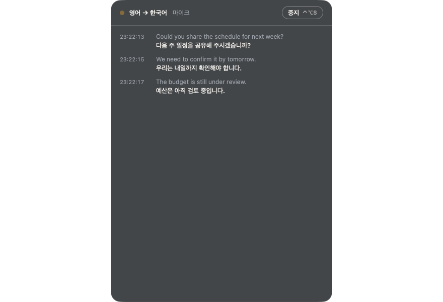
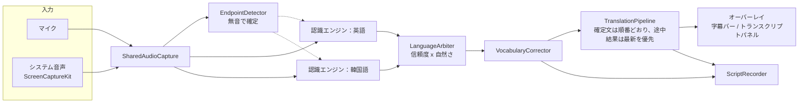

[English](README.md) · [한국어](README.ko.md) · **日本語** · [简体中文](README.zh-CN.md)



<div align="center">

# Ieum · 이음

**会議のためのリアルタイム字幕と翻訳。お使いの Mac の中で、完全にオフラインで。**

相手の話はあなたの言語で読み、あなたの話は相手が自分の言語で読みます。

> 🫥 **画面共有中も、相手には見えません。** 字幕は初期設定で画面共有と録画から隠されます。Zoom、Meet、Teams で画面を共有しても、相手にあなたの翻訳字幕バーや Ieum の設定などのウインドウは見えません。macOS 26 の ScreenCaptureKit でのみ確認しました（macOS 14・15 やすべてのアプリで確認したわけではなく、ウインドウ 1 枚だけの共有やシステムのダイアログは対象外なので、先にテスト通話で確かめてください。設定でオフにできます）。ポインタが字幕バーに近づくと、バーが半透明になってクリックを後ろのウインドウに通すか、画面の反対側へ避けます。


[機能](#機能) · [インストール](#インストール) · [使い方](#使い方) · [ドキュメント](#ドキュメント) · [アーキテクチャ](#アーキテクチャ) · [ビルド](#ソースからビルド) · [パフォーマンス](#パフォーマンス) · [トラブルシューティング](#トラブルシューティング)

</div>

---

## なぜ Ieum か

*Ieum*（이음。イウム、韓国語で“つなぐ”）は、もともとひとつの場面のために作られました。英語を母語とする人たちとの会議に出る、韓国語話者です。
相手が話すと、あなたは韓国語で読みます。あなたが韓国語で答えると、相手には英語が表示されます。現在は英語・韓国語・日本語・中国語（簡体字）のうち、任意の 2 言語で使えます。

- **Mac の外には何も出ません。** 音声認識には Apple の Speech フレームワーク、翻訳には Apple の Translation フレームワークを使い、どちらもデバイス上で動作します。アカウントもクラウドもありません。唯一のネットワーク通信は、1 日 1 回新しいバージョンを確認する任意の機能です（音声・テキスト・識別子は送りません。設定でオフにできます）。
- **遅延が小さい。** 英語と韓国語では、話し始めて約 0.5 秒で最初の単語が表示され、その後は単語ごとに続きます。言い終えた文は約 1 秒後に翻訳されます。日本語と中国語は文単位で表示されます。
- **会議のテーブルのために。** 部屋の反対側からでも読める大きな字幕バー、さかのぼって読めるトランスクリプト、会議のあとのために保存されるスクリプト。

## 機能

アプリの画面表示は英語と韓国語のみです（日本語・中国語の表示はありません）。以下では、設定項目の場所を英語の表示名と日本語の説明で示します。

| | |
|---|---|
| **新機能の紹介** | アップデート後、前回使っていたバージョン以降の変更点を短いアニメーションで紹介します。設定 → `About`（情報）から再表示できます。 |
| **アップデート** | 1 日 1 回新しいバージョンを確認し、インストールの前に確認を求めます。アップデートをダウンロードし、SHA-256、開発者署名、Apple の公証を検証してから自身を置き換え、再起動します。 |
| **お試し** | 組み込みのテストがスピーカーから文をひとつ再生し、それが字幕と翻訳として戻ってくる様子を表示します。会議の前に動作を確認できます。何も保存されません。 |
| **言語** | 英語、韓国語、日本語、中国語（簡体字）。聞く言語と読む言語を、このうち任意の 2 つから選びます（字幕だけなら翻訳なし）。`Both sides speak`（双方が話す）をオンにすると、Ieum は文ごとに言語を判定し、もう一方の言語に翻訳します。日本語と中国語の認識モデルは、初めて使うときに macOS がダウンロードします。 |
| **話したそばから表示される単語** | （英語・韓国語）話し始めて約 0.5 秒で最初の単語が表示され、その後は単語ごとに続きます。2 つ目の認識エンジンが単語を早めに表示し、より正確なエンジンが文ごとに確定します。 |
| **字幕バー** | ひと目で読める大きな文字。行数、文字サイズ、背景のスタイル、不透明度を調整できます。すべてのウインドウの前面に置くことも、通常のウインドウのように扱うこともでき、クリックを透過させることもできます。 |
| **返信ヘルパー** | 答えなければならないのに言葉に詰まったら、**⌃⌥R**（またはバーの吹き出しボタン）を押し、読む側の言語で言いたいことを書くと、字幕バーの横に、相手の言語でそのまま読める文が出ます。端末内の翻訳を逆方向に使うので、何も Mac の外に出ません。Apple Intelligence があれば、続けて自然な言い回しに整えます（質問・数字・名前が保たれるときだけ使い、直訳も表示されたままです）。ワンクリックでコピーでき、Zoom や Teams のチャットに貼り付けられます。マイクボタンで小声で話して入力することもできます。字幕バーと同様、画面共有から隠されます。 |
| **画面共有でも安全** | 初期設定で画面共有と録画から隠されます（`sharingType = .none`）。macOS 26 の ScreenCaptureKit で確認済みで、`Scripts/check-share-safe.swift` で同じ確認をお使いの Mac で繰り返せます。ウインドウ 1 枚だけの共有は対象外です。設定 → 画面 → 画面共有でオフにできます。 |
| **よけてくれる字幕バー** | 字幕の表示中にポインタがバーに近づくと、半透明になってクリックを後ろのウインドウに通す（初期設定）か、画面の反対側の端へ移動します。右端のボタンの上ではそのままです。設定 → 画面。 |
| **トランスクリプトパネル** | タイムスタンプ付きでさかのぼれる表示。テキストを選択でき、自動でスクロールします。聞こえた文と翻訳にそれぞれ言語表示（EN、KO）が付き。議事録は専用の画面で開き、会話に戻れます。 |
| **会議用語集** | 登録した名前や専門用語を、翻訳の前にトランスクリプト上で修正します。 |
| **保存されるスクリプト** | 会議ごとに 1 ファイル：`[HH:mm:ss] text` と `→ translation` の行、交互に話すモードでは `[EN]`/`[KO]` タグ付き。各行の時刻は文を**話した時点**です。設定 → 記録に一覧があります。 |
| **名前と書き出し** | **名前の変更…**でタイムスタンプの代わりに「対策会議」のような名前を付けると、横にある書き出しファイルも一緒に変わります。**書き出し**で、スクリプトを字幕（原文と翻訳の `.srt`、翻訳のみの `.srt`、`.vtt`）や Markdown ノート（`.md`）にできます。 |
| **場面の選択** | **会話**・**会議**・**セミナー／講演** から選びます（トランスクリプトパネルの上部や停止中の字幕バーにあるラベル、または ⋯ メニュー、メニューバー、設定）。選択によって使えるものが変わります。セミナーは聞くだけなので「交互に話す」モードも通話入力もなく、会話は同じ場所なので交互に話す設定で始まり、会議はすべての音声入力が使えます。まとめの形も場面ごとに変わります。 |
| **議事録の下書き** | **Apple Intelligence のある Mac（macOS 26）でのみ**使えます。それ以外の Mac ではこの項目は表示されません。字幕を止めたときにパネルの下に出る案内（⋯ メニュー、メニューバー、**書き出し → 議事録の下書き** でも可）で、端末内の言語モデル（Apple Intelligence、macOS 26）が、読む側の言語で要約・決定事項・やることを `<名前>-minutes.md` に書きます。各項目には根拠にしたトランスクリプトの行番号と時刻が付き、根拠のない項目は印が付きます。確認用の下書きであり、確定した記録ではありません。小さなモデルなので、質問を決定事項として書いたり、誰がいつまでにを落としたりすることがあります。データはMacの外に出ません。Apple Intelligenceが使えないときは、理由とともに選べなくなります。 |
| **通話：誰が話したか** | 音声入力で *通話（マイク + システム音声）* を選ぶと、相手（システム音声）は相手の言語、自分（マイク）は自分の言語で認識し、各行に「自分」または「相手」を表示して、両方向に翻訳します。macOS 26 が必要です。ヘッドフォンが最適で、スピーカーの場合はエコーフィルターが相手の声を自分の発言として表示しないようにします。 |
| **音声入力** | マイク（システムのデフォルト、または USB マイクやスピーカーフォンなど特定のデバイス）、または ScreenCaptureKit によるシステム音声（ビデオ通話、録音）。 |
| **メニューバーアプリ** | メニューバーに常駐し、グローバルショートカットとログイン時の起動に対応します。 |
| **韓国語と英語のインターフェイス** | 初回起動時の権限チェックも含みます。 |
| **コマンドラインツール** | `caption-cli` は同じ認識エンジンをターミナルで実行します（テキストまたは JSON Lines）。 |

## 動作環境

| | 最小 | 必要な機能 |
|---|---|---|
| macOS | 14 | 従来の認識エンジンによる字幕 |
| macOS | 26 | 高速な認識エンジン（`SpeechAnalyzer`） |
| macOS | 26.4 | 会話モードとオフライン翻訳 |
| ハードウェア | Apple silicon | リリースビルドは `arm64` |

言語モデルは、その言語を初めて使うときに macOS がダウンロードします。その後はすべてオフラインで動作します。

## インストール

**ディスクイメージから。** `Ieum.dmg` を開き、Ieum をアプリケーションフォルダにドラッグして起動します。Ieum はメニューバーに表示され、短いセットアップ画面で以下の権限を求めます。

**Homebrew で。** `brew install --cask stoneidev/tap/ieum`（cask は [stoneidev/homebrew-tap](https://github.com/stoneidev/homebrew-tap) にあります）。

**ソースから。** [ソースからビルド](#ソースからビルド)を参照してください。

### 権限

| 権限 | 理由 | 求められるタイミング |
|---|---|---|
| マイク | 部屋の音声を聞くため | 初回起動時 |
| 音声認識 | デバイス上での認識 | 初回起動時 |
| 画面収録とシステムオーディオ録音 | *システム音声* 入力を使う場合のみ | その入力を初めて選んだとき |

システム設定で権限をオンにしたら、Ieum を完全に終了してから開き直してください。

## 使い方

1. メニューバーの Ieum アイコンをクリックし、`Language you hear`（聞く言語）と `Language you read`（読む言語）を選びます。
2. **⌃⌥S**（またはメニューの `Start captions`（字幕を開始））を押します。画面下部に字幕バーが表示されます。
3. **⌃⌥D** で字幕バーとトランスクリプトパネルを切り替えます。
4. もう一度 **⌃⌥S** を押すと停止します。スクリプトは `~/Documents/Ieum Transcripts` に保存されます。
5. 終わったら **設定 → 記録** で **名前の変更…** をして名前を付け（停止の直後ならメニューの **この会議に名前を付ける…** でも可）、**書き出し** で字幕（`.srt`、`.vtt`）や Markdown ノートを作ります。字幕の時刻 0 は字幕を開始した時点なので、録画と同時に開始すれば合います。

### ショートカット

| ショートカット | 操作 |
|---|---|
| ⌃⌥S | 開始 / 停止 |
| ⌃⌥H | オーバーレイの表示 / 非表示 |
| ⌃⌥D | 字幕バー ↔ トランスクリプトパネル |
| ⌃⌥L | 翻訳の方向を入れ替える |

### 設定

`General`（一般：言語、音声入力、ログイン時に開く、グローバルショートカット、インターフェイスの言語） · `Display`（表示：バーまたはパネル、行数、文字サイズ、翻訳のレイアウト、背景と不透明度、クリック透過） · `Vocabulary`（用語集） · `Transcripts`（記録） · `About`（情報）。

### コマンドライン

```sh
caption-cli --locale en-US                       # live captions from the microphone
caption-cli --locale ko-KR --format jsonl        # machine-readable output
caption-cli --source system --locale en-AU       # captions for what the Mac is playing
caption-cli --word Kubernetes --word Siobhan     # favor names and jargon
caption-cli --list-locales                       # supported on-device locales
```

Ctrl+C で停止します。未確定のテキストは先に出力されます。すべてのオプションは `caption-cli --help` で確認できます。

## ドキュメント

| | |
|---|---|
| [ユーザーガイド（韓国語）](docs/USER-GUIDE.md) | インストール、モード、画面の見方、設定、用語集、ショートカット、トラブルシューティング（スクリーンショット付き） |
| [製品要件（韓国語）](docs/PRD.md) | Ieum の目的、受け入れ基準付きの要件、根拠付きの判断、既知の制限 |
| [ベンチマーク（英語）](docs/BENCHMARKS.md) | 遅延と精度の測定、試して採用しなかった実験 |
| [UX レビュー（韓国語）](docs/UX-REVIEW.md) | インターフェイスの背景にある発見と判断 |
| [AGENTS.md（英語）](AGENTS.md) | 開発を引き継ぐ人のために：リポジトリの構成、コマンド、失敗から生まれたルール、リリース手順 |



## アーキテクチャ



- **認識エンジン** は macOS 26 では `SpeechAnalyzer`/`SpeechTranscriber` を使い、それ以外では `SFSpeechRecognizer` にフォールバックします。
- **会話モード** は、選んだ 2 言語（図では英語と韓国語）の認識エンジンを 1 つずつ、同じ音声に対して動かします。`LanguageArbiter` が認識エンジンの信頼度と `NaturalLanguage` による自然さから文ごとに言語を選び、話された順に文を出力します。
- **翻訳** には Apple の Translation フレームワークを使います。確定した文は順番どおりに翻訳し、途中のテキストは最新のものだけを翻訳するので、遅いリクエストが新しい発話を妨げることはありません。古い発話から遅れて届いた結果は破棄します。
- **用語集** による修正は認識のあとに行います。Apple の `SpeechTranscriber` が contextual strings を無視するためです。
- **言語** のルールは `MeetingSetup` にシンプルなルールとしてまとめ、UI から切り離しています。

### ソースの構成

| パス | 内容 |
|---|---|
| `Sources/CaptionCore` | 音声キャプチャ、認識エンジン、会話の言語判定、翻訳パイプライン、トランスクリプトの記録。以下のすべてで共有します。 |
| `Sources/OverlayApp` | メニューバーアプリ：オーバーレイウインドウ、設定、セットアップ。プロダクト `Ieum` をビルドします。 |
| `Sources/CaptionCLI` | コマンドラインの認識ツール、プロダクト `caption-cli`。 |
| `Sources/CaptionBench` | ベンチマークツール、プロダクト `caption-bench`。 |
| `Tests/CaptionCoreTests` | コアライブラリのユニットテスト（Swift Testing）。 |
| `Resources` | Info.plist、entitlements、アプリアイコン。 |
| `Benchmarks` | 音声の生成、参照テキスト、実行スクリプト、結果。 |
| `site` | 製品のウェブサイト。Cloudflare Pages にデプロイする静的 HTML（`npx wrangler pages deploy site --project-name ieum`）。 |
| `docs` | [UX レビュー](docs/UX-REVIEW.md)と[ベンチマークのメモ](docs/BENCHMARKS.md)。 |

## ソースからビルド

Apple silicon 上の Xcode 26（Swift 6）が必要です。

```sh
make build        # caption-cli, ad-hoc signed
make app          # .build/app/Ieum.app, ad-hoc signed, runs on this Mac only
make test         # 130 tests
make clean
```

できたアプリは `open .build/app/Ieum.app` で開きます。

### 署名と公証済みのリリース

*Developer ID Application* 証明書と `notarytool` のキーチェーンプロファイル（`xcrun notarytool store-credentials`）が必要です。

```sh
make app-release SIGN_IDENTITY="Developer ID Application: Your Name (TEAMID)" NOTARY_PROFILE=<profile>
make dmg         SIGN_IDENTITY="Developer ID Application: Your Name (TEAMID)" NOTARY_PROFILE=<profile>
```

`make app-release` は hardened runtime で署名し、Apple に提出し、チケットをステープルして Gatekeeper のチェックを実行します。
`make dmg` はすでに `.build/app` にあるアプリをパッケージにするため、ステープルされたチケットはそのまま残ります。

バンドル ID は `today.calmwork.ieum`（`ieum.calmwork.today` を逆にしたもの）で、`Resources/App/Info.plist` で設定しています。プロジェクトをフォークする場合は、ご自身の逆ドメイン形式の ID を使ってください。

## パフォーマンス

`make bench` で測定しました。合成音声を実際のエンジンにリアルタイムで流します（バージョン 0.2.0、Apple silicon、macOS 26.6）。

| 指標 | 結果 |
|---|---|
| 話し始めてから最初のテキストまで | 約 1.0 秒 |
| 話し終えてから確定テキストまで | 約 0.9 秒 |
| 確定した文の翻訳 | その約 1.2 秒後 |
| 会話モードで正しい言語を選んだ割合 | 100 %（4 文中 4 文、英語と韓国語が混在） |
| 実行中の CPU | 2–4 % |
| メモリ | 約 25 MB |

これらの数値はクリーンな合成音声によるもので、実際の会議室ではありません。話者が遠い、発話が重なる、反響があるといった条件では悪くなります。
`make bench LABEL=<name> [BASELINE=<earlier label>]` は `Benchmarks/results/<name>.md` を書き出します。バージョン間で何が変わったか、数値からはわからないことは何かについては
[docs/BENCHMARKS.md](docs/BENCHMARKS.md) を参照してください。

## トラブルシューティング

| 症状 | 対処 |
|---|---|
| アプリが権限を再び求める | システム設定でオンにしてから、Ieum を完全に終了して開き直してください。アプリを再署名した場合は、権限の一覧から削除してから追加し直してください。 |
| システム音声が入らない | *画面収録とシステムオーディオ録音* を許可してから、アプリを開き直してください。ディスプレイがスリープしてもキャプチャは止まります。 |
| 翻訳が表示されない | macOS 26.4 以降が必要です。まだ Mac に入っていない翻訳言語は、⋯ メニュー > `Permissions and setup…` > `Download language` から一度だけダウンロードできます（ネットワークが必要）。システム設定 > 一般 > 言語と地域 > 翻訳言語 からも追加できます。 |
| 字幕が遅い、または表示されない | ステータス表示を確認してください。*listening*（聞き取り中）、*idle*（待機中）、またはエラーと次にすべきことが表示されます。 |
| 名前が何度も聞き間違えられる | 設定 → `Vocabulary`（用語集）に追加してください。 |

## プライバシー

音声は Mac のメモリ上で処理され、ディスクには一切書き込まれません。保存されるのはテキストだけで、会議のスクリプトとして設定に表示されるフォルダに保存されます。
Ieum が行う唯一のネットワーク通信は、任意のアップデート確認です。1 日 1 回 `https://ieum.calmwork.today/latest.json`（数百バイト）を読み込みます。それ以外には何も送信せず、アップデートはあなたが同意したあとにのみダウンロード・インストールされます。設定 → `General`（一般）で確認をオフにすると、アプリは一切の通信を行いません。macOS は、ある言語を初めて使うときに言語モデルをダウンロードすることがあります。何度か使ったあと、会議が終わると Ieum がコーヒー1杯分の価値があったかを一度だけ[尋ねます](https://buymeacoffee.com/stoni)。回数は Mac の中にだけ保存され、何も送信されず、ページはクリックしたときだけ開き、設定でオフにできます。

## ステータス

バージョン 0.15.0。まだ検証していないこと：複数の話者がいる実際の会議室での使用、macOS 26 より前での動作、Ieum の名前で公証されたビルド。

## ライセンス

Ieum は [Apache License 2.0](LICENSE) で提供されています。仕事でも家庭でも自由に使え、改変や再配布もできます。「Ieum」という名前とロゴはライセンスの対象外です（[NOTICE](NOTICE) を参照）。

ウェブサイトのフォント（Plus Jakarta Sans、Noto Sans KR）とアプリ独自のウインドウのフォント（Ieum Sans、Pretendard のサブセットを改名したもの）は SIL Open Font License に従います。`site/fonts` と `Resources/App/Fonts` を参照してください。
