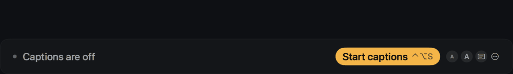
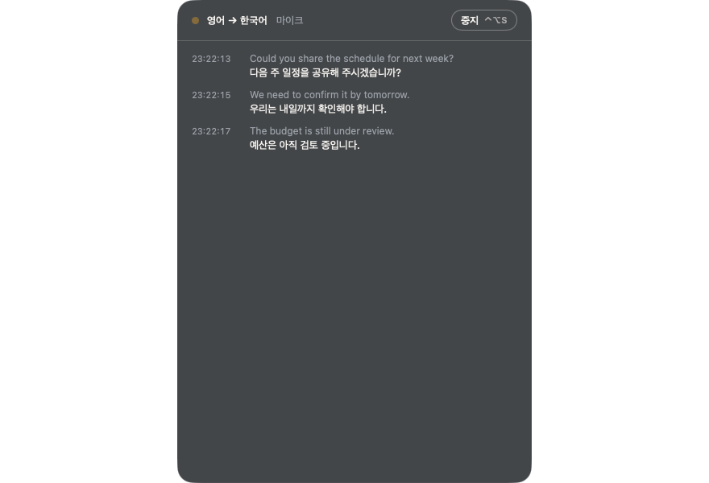
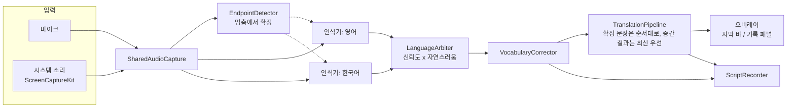

[English](README.md) · **한국어** · [日本語](README.ja.md) · [简体中文](README.zh-CN.md)



<div align="center">

# Ieum · 이음

**회의를 위한 실시간 자막과 번역. 내 Mac 안에서, 완전히 오프라인으로.**

상대가 하는 말은 내 언어로 읽고, 내가 하는 말은 상대가 자기 언어로 읽습니다.


[기능](#기능) · [설치](#설치) · [사용법](#사용법) · [문서](#문서) · [구조](#구조) · [빌드](#소스에서-빌드) · [성능](#성능) · [문제 해결](#문제-해결)

</div>

---

## 왜 Ieum인가

*이음*은 "잇는다"는 뜻입니다. 처음에는 한 가지 상황을 위해 만들었습니다. 영어가 모국어인 사람들과 회의하는 한국어 사용자입니다.
상대가 말하면 나는 한국어로 읽습니다. 내가 한국어로 답하면 상대에게는 영어가 보입니다. 지금은 영어, 한국어, 일본어, 중국어(간체) 중 어떤 두 언어든 쓸 수 있습니다.

- **아무것도 Mac 밖으로 나가지 않습니다.** 인식은 Apple Speech 프레임워크, 번역은 Apple Translation 프레임워크를 쓰며 둘 다 기기 안에서 동작합니다. 계정도 클라우드도 없습니다. 유일한 네트워크 요청은 하루 한 번 새 버전을 확인하는 선택 기능입니다(음성·글자·식별 정보 없음, 설정에서 끌 수 있음).
- **지연이 짧습니다.** 영어와 한국어는 말을 시작하고 약 0.5초 뒤 첫 단어가 나타나고 이후 단어 단위로 따라옵니다. 끝난 문장은 약 1초 뒤 번역됩니다. 일본어와 중국어는 문장 단위로 나옵니다.
- **회의 테이블을 위해 만들었습니다.** 방 건너편에서도 읽을 수 있는 큰 자막 바, 지난 내용을 되짚어 볼 수 있는 기록, 회의가 끝난 뒤를 위한 기록 파일.

## 기능

| | |
|---|---|
| **새로운 기능 안내** | 업데이트 후, 마지막으로 쓰던 버전 이후 달라진 점을 짧은 애니메이션으로 보여 줍니다. 설정 → 정보에서 다시 열 수 있습니다. |
| **업데이트** | 하루 한 번 새 버전을 확인하고, 설치 전에 먼저 묻습니다. 업데이트를 내려받아 SHA-256, 개발자 서명, Apple 공증을 확인한 뒤 앱을 교체하고 다시 엽니다. |
| **체험해 보기** | 내장 테스트가 스피커로 문장을 하나 들려주고, 그것이 자막과 번역으로 돌아오는 것을 보여 줍니다. 회의 전에 제대로 동작하는지 알 수 있습니다. 아무것도 저장되지 않습니다. |
| **언어** | 영어, 한국어, 일본어, 중국어(간체). **듣는 언어**와 **보는 언어**를 이 중 어떤 두 언어로든 고릅니다(자막만 보려면 번역 없음). **서로 번갈아 말함**을 켜면 문장마다 언어를 알아내 다른 언어로 번역합니다. 일본어와 중국어 인식 모델은 처음 쓸 때 macOS가 내려받습니다. |
| **말하는 대로 바로 보이는 단어** | (영어·한국어) 말을 시작하고 약 0.5초 뒤 첫 단어가 나타나고 이후 단어 단위로 이어집니다. 두 번째 인식기가 단어를 일찍 보여 주고, 더 정확한 인식기가 문장마다 확정합니다. |
| **자막 바** | 한눈에 읽을 수 있는 큰 글자. 줄 수, 글자 크기, 배경 스타일, 투명도를 조절할 수 있습니다. 모든 창 위에 둘 수도, 일반 창처럼 둘 수도 있고, 클릭 통과도 됩니다. |
| **기록 패널** | 시각이 붙은 지난 문장 목록. 글자를 선택할 수 있고 자동으로 스크롤됩니다. |
| **회의 용어집** | 적어 둔 이름과 전문 용어를 번역 전에 기록에서 바로잡습니다. |
| **저장되는 기록** | 회의마다 파일 하나: `[HH:mm:ss] text`와 `→ translation` 줄, 대화 모드에서는 `[EN]`/`[KO]` 태그. 설정에 목록이 있고, **이름 바꾸기**로 "대책회의"처럼 이름을 붙이고 **내보내기**로 자막 파일(`.srt`, `.vtt`)이나 Markdown 노트로 바꿀 수 있습니다. 시각은 문장을 말한 때입니다. |
| **소리 입력** | 마이크(시스템 기본 또는 USB 마이크, 스피커폰 같은 특정 장치), 또는 ScreenCaptureKit을 통한 시스템 소리(화상회의, 녹음). |
| **메뉴 막대 앱** | 메뉴 막대에 있으며 전역 단축키와 로그인할 때 열기를 지원합니다. |
| **한국어와 영어 화면** | 첫 실행 때의 권한 점검도 포함합니다. |
| **명령줄 도구** | `caption-cli`는 같은 인식기를 터미널에서 실행합니다(텍스트 또는 JSON Lines). |

## 요구 사항

| | 최소 | 필요한 기능 |
|---|---|---|
| macOS | 14 | 이전 인식기로 자막 |
| macOS | 26 | 빠른 인식기 (`SpeechAnalyzer`) |
| macOS | 26.4 | 대화 모드와 오프라인 번역 |
| 하드웨어 | Apple silicon | 릴리스 빌드는 `arm64` |

언어 모델은 어떤 언어를 처음 쓸 때 macOS가 내려받습니다. 그 뒤에는 모두 오프라인으로 동작합니다.

## 설치

**디스크 이미지로.** `Ieum.dmg`를 열고 Ieum을 응용 프로그램 폴더로 끌어다 놓은 뒤 실행합니다. Ieum이 메뉴 막대에 나타나고, 짧은 설정 화면이 아래 권한을 요청합니다.

**Homebrew로.** `brew install --cask stoneidev/tap/ieum` (cask는 [stoneidev/homebrew-tap](https://github.com/stoneidev/homebrew-tap)에 있습니다).

**소스에서.** [소스에서 빌드](#소스에서-빌드)를 보세요.

### 권한

| 권한 | 이유 | 요청 시점 |
|---|---|---|
| 마이크 | 회의실의 소리를 듣습니다 | 첫 실행 |
| 음성 인식 | 기기 내 인식 | 첫 실행 |
| 화면 및 시스템 오디오 녹음 | *시스템 소리* 입력에만 필요 | 그 입력을 처음 고를 때 |

시스템 설정에서 권한을 켠 뒤에는 Ieum을 완전히 종료했다가 다시 여세요.

## 사용법

1. 메뉴 막대의 Ieum 아이콘을 누르고 **듣는 언어**와 **보는 언어**를 고릅니다.
2. **⌃⌥S**(또는 메뉴의 **자막 시작**)를 누릅니다. 화면 아래에 자막 바가 나타납니다.
3. **⌃⌥D**로 자막 바와 기록 패널을 오갑니다.
4. **⌃⌥S**를 다시 누르면 멈춥니다. 기록은 `~/Documents/Ieum Transcripts`에 저장됩니다.

### 단축키

| 단축키 | 동작 |
|---|---|
| ⌃⌥S | 시작 / 중지 |
| ⌃⌥H | 오버레이 보이기 / 숨기기 |
| ⌃⌥D | 자막 바 ↔ 기록 패널 |
| ⌃⌥L | 번역 방향 바꾸기 |

### 설정

일반(언어, 소리 입력, 로그인할 때 열기, 전역 단축키, 화면 언어) · 화면(바 또는 패널, 줄 수, 글자 크기, 번역 표시, 배경과 투명도, 클릭 통과) · 용어집 · 기록 · 정보.

### 명령줄

```sh
caption-cli --locale en-US                       # live captions from the microphone
caption-cli --locale ko-KR --format jsonl        # machine-readable output
caption-cli --source system --locale en-AU       # captions for what the Mac is playing
caption-cli --word Kubernetes --word Siobhan     # favor names and jargon
caption-cli --list-locales                       # supported on-device locales
```

Ctrl+C로 멈춥니다. 남은 글자를 먼저 내보냅니다. 모든 옵션은 `caption-cli --help`로 볼 수 있습니다.

## 문서

| | |
|---|---|
| [사용자 가이드 (한국어)](docs/USER-GUIDE.md) | 설치, 모드, 화면 읽는 법, 설정, 용어집, 단축키, 문제 해결. 스크린샷 포함 |
| [제품 요구 사항 (한국어)](docs/PRD.md) | Ieum의 목적, 수용 기준이 있는 요구 사항, 근거가 있는 결정, 알려진 한계 |
| [벤치마크 (영어)](docs/BENCHMARKS.md) | 지연과 정확도 측정, 시도했다가 버린 실험 |
| [UX 리뷰 (한국어)](docs/UX-REVIEW.md) | 화면 설계 뒤의 발견과 결정 |
| [AGENTS.md (영어)](AGENTS.md) | 작업을 이어 갈 사람을 위해: 저장소 지도, 명령, 실수에서 나온 규칙, 릴리스 절차 |



## 구조



- **인식기**는 macOS 26에서 `SpeechAnalyzer`/`SpeechTranscriber`를 쓰고, 그렇지 않으면 `SFSpeechRecognizer`로 대신합니다.
- **대화 모드**는 고른 두 언어(위 그림에서는 영어와 한국어)의 인식기를 하나씩 같은 소리에 돌립니다. `LanguageArbiter`가 인식기 신뢰도와 `NaturalLanguage`가 판단한 자연스러움으로 문장마다 언어를 고르고, 말한 순서대로 문장을 내보냅니다.
- **번역**은 Apple Translation 프레임워크를 씁니다. 확정된 문장은 순서대로 번역하고, 중간 결과는 최신 것만 번역하므로 느린 요청이 새 말을 막지 않습니다. 이전 발화에서 늦게 온 결과는 버립니다.
- **용어집** 교정은 인식 뒤에 실행됩니다. Apple의 `SpeechTranscriber`가 contextual strings를 무시하기 때문입니다.
- **언어** 규칙은 `MeetingSetup`에 단순한 규칙으로 있고, UI와 분리되어 있습니다.

### 소스 구성

| 경로 | 내용 |
|---|---|
| `Sources/CaptionCore` | 오디오 캡처, 인식기, 대화 언어 판정, 번역 파이프라인, 기록 저장. 아래 모든 것이 공유합니다. |
| `Sources/OverlayApp` | 메뉴 막대 앱: 오버레이 창, 설정, 초기 설정. 제품 `Ieum`을 빌드합니다. |
| `Sources/CaptionCLI` | 명령줄 인식기, 제품 `caption-cli`. |
| `Sources/CaptionBench` | 벤치마크 도구, 제품 `caption-bench`. |
| `Tests/CaptionCoreTests` | 코어 라이브러리 단위 테스트 (Swift Testing). |
| `Resources` | Info.plist, entitlements, 앱 아이콘. |
| `Benchmarks` | 음성 생성, 기준 텍스트, 실행기, 결과. |
| `site` | 제품 웹사이트. Cloudflare Pages에 배포하는 정적 HTML (`npx wrangler pages deploy site --project-name ieum`). |
| `docs` | [UX 리뷰](docs/UX-REVIEW.md)와 [벤치마크 기록](docs/BENCHMARKS.md). |

## 소스에서 빌드

Apple silicon에서 Xcode 26 (Swift 6)이 필요합니다.

```sh
make build        # caption-cli, ad-hoc signed
make app          # .build/app/Ieum.app, ad-hoc signed, runs on this Mac only
make test         # 130 tests
make clean
```

결과물은 `open .build/app/Ieum.app`으로 엽니다.

### 서명과 공증을 거친 릴리스

*Developer ID Application* 인증서와 `notarytool` 키체인 프로필(`xcrun notarytool store-credentials`)이 필요합니다.

```sh
make app-release SIGN_IDENTITY="Developer ID Application: Your Name (TEAMID)" NOTARY_PROFILE=<profile>
make dmg         SIGN_IDENTITY="Developer ID Application: Your Name (TEAMID)" NOTARY_PROFILE=<profile>
```

`make app-release`는 hardened runtime으로 서명하고 Apple에 제출한 뒤, 티켓을 스테이플하고 Gatekeeper 검사를 실행합니다.
`make dmg`는 이미 `.build/app`에 있는 앱을 패키징하므로 스테이플된 티켓이 유지됩니다.

번들 ID는 `today.calmwork.ieum`(`ieum.calmwork.today`를 거꾸로 쓴 것)이며 `Resources/App/Info.plist`에 설정되어 있습니다. 프로젝트를 포크한다면 자신의 reverse-DNS ID를 쓰세요.

## 성능

`make bench`로 측정했습니다. 합성 음성을 실제 엔진에 실시간으로 흘려보냅니다(버전 0.2.0, Apple silicon, macOS 26.6).

| 항목 | 결과 |
|---|---|
| 말을 시작한 뒤 첫 글자 | 약 1.0초 |
| 말이 끝난 뒤 확정 글자 | 약 0.9초 |
| 확정 문장 번역 | 약 1.2초 뒤 |
| 대화 모드, 올바른 언어 선택 | 100 % (4문장 중 4문장, 영어와 한국어 섞음) |
| 실행 중 CPU | 2–4 % |
| 메모리 | 약 25 MB |

이 숫자는 깨끗한 합성 음성에서 나온 것이며 실제 회의실이 아닙니다. 멀리 있는 화자, 동시 발화, 울림이 있으면 더 나빠집니다.
`make bench LABEL=<name> [BASELINE=<earlier label>]`은 `Benchmarks/results/<name>.md`를 씁니다. 버전 사이에 무엇이 바뀌었는지, 숫자가 말해 주지 않는 것은 무엇인지는
[docs/BENCHMARKS.md](docs/BENCHMARKS.md)를 보세요.

## 문제 해결

| 증상 | 해결 |
|---|---|
| 앱이 권한을 다시 요청한다 | 시스템 설정에서 켠 뒤 Ieum을 완전히 종료하고 다시 여세요. 앱을 다시 서명했다면 권한 목록에서 지웠다가 다시 추가하세요. |
| 시스템 소리가 안 들어온다 | *화면 및 시스템 오디오 녹음*을 허용한 뒤 앱을 다시 여세요. 디스플레이가 잠자기에 들어가도 캡처가 멈춥니다. |
| 번역이 안 나온다 | macOS 26.4 이상이 필요합니다. Mac에 아직 없는 번역 언어는 ⋯ 메뉴 > `Permissions and setup…`(권한 및 설정 점검) > `Download language`(언어 내려받기)에서 한 번 내려받을 수 있습니다(네트워크 필요). 시스템 설정 > 일반 > 언어 및 지역 > 번역 언어에서도 추가할 수 있습니다. |
| 자막이 느리거나 안 나온다 | 상태 표시를 확인하세요. *듣는 중*, 대기 상태, 또는 오류와 다음에 할 일을 보여 줍니다. |
| 이름이 계속 틀리게 들린다 | 설정 → 용어집에 추가하세요. |

## 개인정보

음성은 Mac의 메모리에서 처리되며 디스크에 저장되지 않습니다. 글자만 회의 기록으로, 설정에 표시된 폴더에 저장됩니다.
Ieum이 하는 유일한 네트워크 요청은 선택 기능인 업데이트 확인입니다. 하루 한 번 `https://ieum.calmwork.today/latest.json`(수백 바이트)을 읽습니다. 그 밖에는 아무것도 보내지 않으며, 업데이트는 동의한 뒤에만 내려받아 설치합니다. 설정 → 일반에서 확인을 끄면 앱은 어떤 요청도 하지 않습니다. 어떤 언어를 처음 쓸 때 macOS가 언어 모델을 내려받을 수 있습니다.

## 상태

버전 0.5.0. 아직 확인하지 못한 것: 여러 사람이 말하는 실제 회의실에서의 사용, macOS 26 이전에서의 동작, Ieum 이름으로 공증된 빌드.

## 라이선스

Ieum은 [Apache License 2.0](LICENSE)으로 배포됩니다. 회사에서든 집에서든 자유롭게 쓰고, 고치고, 다시 배포할 수 있습니다. "Ieum"이라는 이름과 로고는 라이선스에 포함되지 않습니다([NOTICE](NOTICE) 참고).

웹사이트의 글꼴(Plus Jakarta Sans, Noto Sans KR)과 앱 자체 창의 글꼴(Ieum Sans, Pretendard의 일부를 이름을 바꿔 담은 것)은 SIL Open Font License를 따릅니다. `site/fonts`와 `Resources/App/Fonts`를 보세요.
