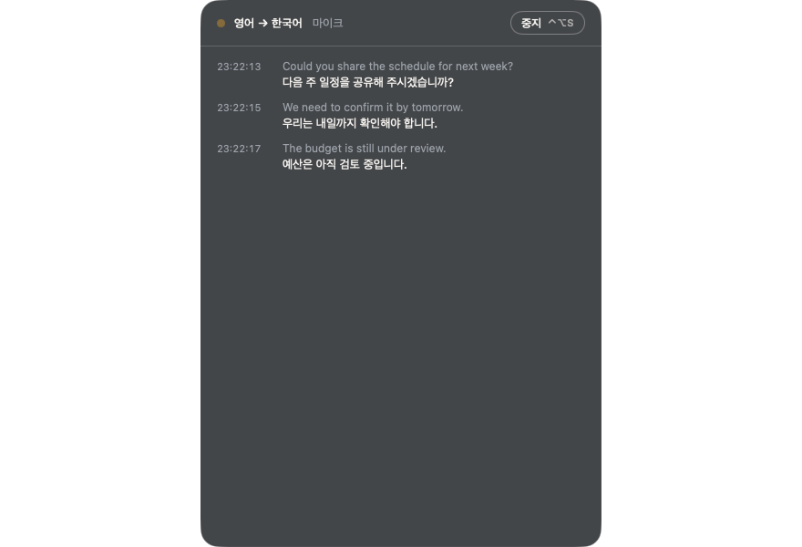
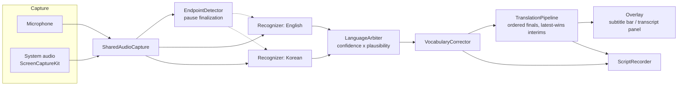

<div align="center">

# Ieum · 이음

**Live captions and translation for meetings. On your Mac, fully offline.**

Read what the other side says in your language, while they read what you say in theirs.


[Features](#features) · [Install](#install) · [Usage](#usage) · [Documentation](#documentation) · [Architecture](#architecture) · [Build](#build-from-source) · [Performance](#performance) · [Troubleshooting](#troubleshooting)

</div>

---

## Why Ieum

*Ieum* (이음) means "to connect". It is built for one situation: a Korean speaker in a meeting with native English speakers.
The other side talks and you read Korean. You answer in Korean and the English is there for them.

- **Nothing leaves the Mac.** Recognition uses Apple's Speech framework and translation uses Apple's Translation framework, both on-device. No account and no cloud. The only network request is an optional once-a-day check for a newer version (no audio, text or identifiers; off in Settings).
- **Low delay.** The first words appear about half a second after you start speaking and then follow word by word; a finished sentence is translated about a second later.
- **Made for the table.** A large subtitle bar you can read from across the room, a transcript you can scroll back through, and a script saved for after the meeting.

## Features

| | |
|---|---|
| **What's new tour** | After an update, a short animated tour shows what changed since the version you last used. Settings → About reopens it. |
| **Updates** | Once a day Ieum checks for a newer version and asks before installing. It downloads the update, verifies the SHA-256, the developer signature and Apple's notarization, then replaces itself and reopens. |
| **Try it** | A built-in test plays a sentence through the speakers and shows it come back as captions and a translation, so you know it works before the meeting. Nothing is saved. |
| **Languages** | English, Korean, Japanese and Chinese (Simplified). Pick the language you hear and the language you read, any two of them (or none, for captions only). Turn on *Both sides speak* and Ieum detects the language of each sentence and translates it into the other. Japanese and Chinese recognition models are downloaded by macOS the first time you use them. |
| **Words as they are spoken** | The first words appear about half a second after you start speaking, then word by word. A second recognizer shows them early; the more accurate one confirms each sentence. |
| **Subtitle bar** | Large text for reading at a glance. Lines, text size, background style and opacity are adjustable. It can stay above every window or behave like an ordinary one, and it can be click-through. |
| **Transcript panel** | Timestamped scrollback with selectable text and auto-scroll. |
| **Meeting vocabulary** | Names and jargon you list are corrected in the transcript before it is translated. |
| **Saved scripts** | One file per meeting: `[HH:mm:ss] text` with `→ translation` lines, and `[EN]`/`[KO]` tags in conversation mode. Listed in Settings. |
| **Audio sources** | Microphone (the system default or a specific one, such as a USB microphone or a speakerphone), or system audio (video calls, recordings) through ScreenCaptureKit. |
| **Menu bar app** | Lives in the menu bar, with global shortcuts and open-at-login. |
| **Korean and English interface** | Including a first-run permission check. |
| **Command-line tool** | `caption-cli` runs the same recognizer in a terminal (text or JSON Lines). |

## Requirements

| | Minimum | Needed for |
|---|---|---|
| macOS | 14 | Captions with the legacy recognizer |
| macOS | 26 | The fast recognizer (`SpeechAnalyzer`) |
| macOS | 26.4 | Conversation mode and offline translation |
| Hardware | Apple silicon | The release build is `arm64` |

Language models are downloaded by macOS the first time you use a language. After that everything works offline.

## Install

**From a disk image.** Open `Ieum.dmg`, drag Ieum to Applications and start it. Ieum appears in the menu bar and a short setup screen asks for the permissions below.

**With Homebrew.** `brew install --cask stoneidev/tap/ieum` (the cask lives in [stoneidev/homebrew-tap](https://github.com/stoneidev/homebrew-tap)).

**From source.** See [Build from source](#build-from-source).

### Permissions

| Permission | Why | When it is asked |
|---|---|---|
| Microphone | Hear the room | First start |
| Speech Recognition | On-device recognition | First start |
| Screen & System Audio Recording | Only for the *system audio* source | First time you pick that source |

After turning a permission on in System Settings, quit Ieum completely and open it again.

## Usage

1. Click the Ieum icon in the menu bar and choose the **language you hear** and the **language you read**.
2. Press **⌃⌥S** (or *Start* in the menu). The subtitle bar appears at the bottom of the screen.
3. Press **⌃⌥D** to switch between the subtitle bar and the transcript panel.
4. Press **⌃⌥S** again to stop. The script is saved to `~/Documents/Ieum Transcripts`.

### Shortcuts

| Shortcut | Action |
|---|---|
| ⌃⌥S | Start / stop |
| ⌃⌥H | Show / hide the overlay |
| ⌃⌥D | Subtitle bar ↔ transcript panel |
| ⌃⌥L | Swap the translation direction |

### Settings

General (languages,  audio source, open at login, global shortcuts, interface language) · Display (bar or panel, lines, text size, translation layout, background and opacity, click-through) · Vocabulary · Transcripts · About.

### Command line

```sh
caption-cli --locale en-US                       # live captions from the microphone
caption-cli --locale ko-KR --format jsonl        # machine-readable output
caption-cli --source system --locale en-AU       # captions for what the Mac is playing
caption-cli --word Kubernetes --word Siobhan     # favor names and jargon
caption-cli --list-locales                       # supported on-device locales
```

Press Ctrl+C to stop. Pending text is flushed first. Run `caption-cli --help` for every option.

## Documentation

| | |
|---|---|
| [User guide (한국어)](docs/USER-GUIDE.md) | Install, modes, reading the screen, settings, vocabulary, shortcuts, troubleshooting, with screenshots |
| [Product requirements (한국어)](docs/PRD.md) | What Ieum is for, requirements with acceptance criteria, decisions with their evidence, known limits |
| [Benchmarks](docs/BENCHMARKS.md) | Latency and accuracy measurements, and experiments that were tried and dropped |
| [UX review (한국어)](docs/UX-REVIEW.md) | Findings and decisions behind the interface |
| [AGENTS.md](AGENTS.md) | For anyone continuing the work: repository map, commands, rules that came from mistakes, release runbook |



## Architecture



- **Recognizers** use `SpeechAnalyzer`/`SpeechTranscriber` on macOS 26 and fall back to `SFSpeechRecognizer`.
- **Conversation mode** runs one English and one Korean recognizer on the same audio. `LanguageArbiter` picks the language per sentence from recognizer confidence and `NaturalLanguage` plausibility, and releases sentences in spoken order.
- **Translation** uses the Apple Translation framework. Final sentences are translated in order; interim text is translated latest-wins, so a slow request never blocks newer speech. Late results from an older utterance are discarded.
- **Vocabulary** correction runs after recognition, because Apple's `SpeechTranscriber` ignores contextual strings.
- **Languages** are plain rules in `MeetingSetup`, kept apart from the UI.

### Source layout

| Path | What |
|---|---|
| `Sources/CaptionCore` | Audio capture, recognizers, conversation arbitration, translation pipeline, transcript recorder. Shared by everything below. |
| `Sources/OverlayApp` | The menu-bar app: overlay windows, settings, setup. Builds the product `Ieum`. |
| `Sources/CaptionCLI` | Command-line recognizer, product `caption-cli`. |
| `Sources/CaptionBench` | Benchmark tool, product `caption-bench`. |
| `Tests/CaptionCoreTests` | Unit tests for the core library (Swift Testing). |
| `Resources` | Info.plists, entitlements, app icon. |
| `Benchmarks` | Audio generation, reference texts, runner, results. |
| `site` | The product website, static HTML deployed to Cloudflare Pages (`npx wrangler pages deploy site --project-name ieum`). |
| `docs` | [UX review](docs/UX-REVIEW.md) and [benchmark notes](docs/BENCHMARKS.md). |

## Build from source

Requires Xcode 26 (Swift 6) on Apple silicon.

```sh
make build        # caption-cli, ad-hoc signed
make app          # .build/app/Ieum.app, ad-hoc signed, runs on this Mac only
make test         # 130 tests
make clean
```

Open the result with `open .build/app/Ieum.app`.

### Signed and notarized release

You need a *Developer ID Application* certificate and a `notarytool` keychain profile
(`xcrun notarytool store-credentials`).

```sh
make app-release SIGN_IDENTITY="Developer ID Application: Your Name (TEAMID)" NOTARY_PROFILE=<profile>
make dmg         SIGN_IDENTITY="Developer ID Application: Your Name (TEAMID)" NOTARY_PROFILE=<profile>
```

`make app-release` signs with the hardened runtime, submits to Apple, staples the ticket and runs a Gatekeeper check.
`make dmg` packages the app that is already in `.build/app`, so the stapled ticket is kept.

The bundle id is `today.calmwork.ieum` (reverse of `ieum.calmwork.today`), set in `Resources/App/Info.plist`. Use your own reverse-DNS id if you fork the project.

## Performance

Measured with `make bench`, which plays synthesized speech through the real engines in real time (version 0.2.0, Apple silicon, macOS 26.6):

| Metric | Result |
|---|---|
| First text after speech starts | about 1.0 s |
| Final text after speech ends | about 0.9 s |
| Final sentence translated | about 1.2 s later |
| Conversation mode, right language chosen | 100 % (4 of 4 sentences, English and Korean mixed) |
| CPU while running | 2–4 % |
| Memory | about 25 MB |

These numbers come from clean synthesized speech, not a real room. Distant speakers, crosstalk and echo will be worse.
`make bench LABEL=<name> [BASELINE=<earlier label>]` writes `Benchmarks/results/<name>.md`. See
[docs/BENCHMARKS.md](docs/BENCHMARKS.md) for what changed between versions and what the numbers do not tell you.

## Troubleshooting

| Symptom | What to do |
|---|---|
| The app asks for a permission again | Turn it on in System Settings, then quit Ieum completely and reopen it. After re-signing the app, remove it from the permission list and add it again. |
| No system audio | Allow *Screen & System Audio Recording*, then reopen the app. A sleeping display also stops capture. |
| Translation does not appear | Needs macOS 26.4 or later. The first use of a language pair downloads its model, which needs a network once. |
| Captions are slow or missing | Check the status chip: it shows *listening*, *idle* or an error with the next step. |
| A name keeps being misheard | Add it under Settings → Vocabulary. |

## Privacy

Audio is processed in memory on the Mac and is never written to disk. Only text is saved, as the meeting script, in the folder shown in Settings.
The only network request Ieum makes is the optional update check: once a day it reads `https://ieum.calmwork.today/latest.json` (a few hundred bytes). Nothing else is sent, and an update is downloaded and installed only after you say yes. Turn the check off in Settings → General and the app makes no requests at all. macOS may download a language model the first time you use a language.

## Status

Version 0.4.0. Not yet verified: use in a real meeting room with several speakers, behavior on macOS earlier than 26, and notarized builds under the Ieum name.

## License

Ieum is licensed under the [Apache License 2.0](LICENSE). You may use it freely, at work or at home, and modify and redistribute it. The name "Ieum" and its logo are not part of the license (see [NOTICE](NOTICE)).

The fonts on the website (Plus Jakarta Sans, Noto Sans KR) and the app's own windows (Ieum Sans, a renamed subset of Pretendard) are under the SIL Open Font License; see `site/fonts` and `Resources/App/Fonts`.
