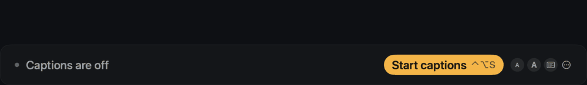
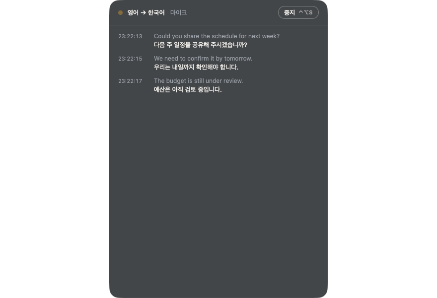
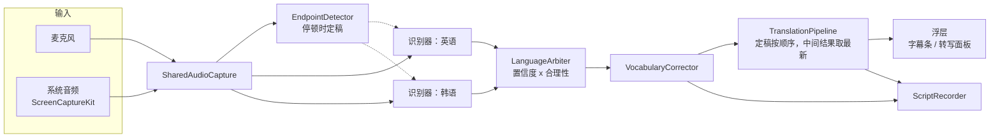

[English](README.md) · [한국어](README.ko.md) · [日本語](README.ja.md) · **简体中文**



<div align="center">

# Ieum · 이음

**为会议提供实时字幕与翻译。在你的 Mac 上运行，完全离线。**

对方说的话，你用自己的语言阅读；你说的话，对方用他们的语言阅读。


[功能](#功能) · [安装](#安装) · [使用](#使用) · [文档](#文档) · [架构](#架构) · [构建](#从源码构建) · [性能](#性能) · [故障排除](#故障排除)

</div>

---

## 为什么是 Ieum

Ieum（韩语“이음”，意为“连接”）最初是为一个场景打造的：一位说韩语的人，与以英语为母语的人开会。
对方说话时，你读到韩语；你用韩语回答，对方看到的是英语。现在，英语、韩语、日语和中文（简体）中的任意两种语言都可以使用。

- **没有任何内容离开 Mac。** 语音识别使用 Apple 的 Speech 框架，翻译使用 Apple 的 Translation 框架，两者都在设备上运行。无需账号，没有云端。唯一的网络请求是可选的每日一次新版本检查（不含音频、文本或标识符；可在设置中关闭）。
- **延迟低。** 英语和韩语在开始说话后约半秒出现第一个词，之后逐词跟上；一句话说完约一秒后完成翻译。日语和中文按整句显示。
- **为会议桌而设计。** 隔着房间也能看清的大字幕条，可以向上回看的转写记录，以及会后保存下来的文字稿。

## 功能

应用界面只有英语和韩语两种（没有中文或日语界面）。下文用英文界面名称加中文说明来指明设置项的位置。

| | |
|---|---|
| **新功能导览** | 更新后，一段简短的动画导览会展示自你上次使用的版本以来的变化。可在设置 → `About`（关于）中重新打开。 |
| **更新** | Ieum 每天检查一次新版本，安装前会先征求你的同意。它会下载更新，校验 SHA-256、开发者签名和 Apple 公证，然后替换自身并重新打开。 |
| **试一试** | 内置测试会通过扬声器播放一句话，并显示它作为字幕和译文回来的过程，让你在会议前确认一切正常。不会保存任何内容。 |
| **语言** | 英语、韩语、日语和中文（简体）。从中任选两种作为听的语言和看的语言（只要字幕时可选择不翻译）。打开 `Both sides speak`（双方轮流说话）后，Ieum 会识别每句话的语言，并翻译成另一种语言。日语和中文的识别模型会在首次使用时由 macOS 下载。 |
| **边说边出字** | （英语和韩语）开始说话后约半秒出现第一个词，之后逐词显示。第二个识别器提前显示词语，更准确的识别器逐句确认。 |
| **字幕条** | 大号文字，一眼就能读懂。行数、字号、背景样式和不透明度均可调整。可以始终位于所有窗口之上，也可以像普通窗口一样，还可以设为点击穿透。 |
| **转写面板** | 带时间戳、可回看的记录，文字可选中，并自动滚动。 |
| **会议词汇表** | 你列出的人名和术语，会在翻译之前在转写中被纠正。 |
| **保存的文字稿** | 每场会议一个文件：`[HH:mm:ss] text` 加上 `→ translation` 行，双方轮流发言时带 `[EN]`/`[KO]` 标签。每行的时间是这句话被**说出的时刻**。可在设置 → 记录中查看列表。 |
| **命名与导出** | 用 **重命名…** 给会议起名（如“对策会议”）代替时间戳，旁边已导出的文件会跟着改名。用 **导出** 可把文字稿变成字幕（原文加译文的 `.srt`、仅译文的 `.srt`、`.vtt`）或 Markdown 笔记（`.md`）。 |
| **音频来源** | 麦克风（系统默认，或指定设备，例如 USB 麦克风或会议扬声器），或通过 ScreenCaptureKit 获取的系统音频（视频通话、录音）。 |
| **菜单栏应用** | 常驻菜单栏，支持全局快捷键和登录时打开。 |
| **韩语和英语界面** | 包括首次启动时的权限检查。 |
| **命令行工具** | `caption-cli` 在终端中运行同样的识别器（文本或 JSON Lines）。 |

## 系统要求

| | 最低 | 用于 |
|---|---|---|
| macOS | 14 | 使用旧版识别器显示字幕 |
| macOS | 26 | 快速识别器（`SpeechAnalyzer`） |
| macOS | 26.4 | 对话模式和离线翻译 |
| 硬件 | Apple silicon | 发布版为 `arm64` |

首次使用某种语言时，macOS 会下载对应的语言模型。之后一切都可离线运行。

## 安装

**通过磁盘映像。** 打开 `Ieum.dmg`，将 Ieum 拖到“应用程序”文件夹并启动。Ieum 会出现在菜单栏中，一个简短的设置界面会请求下列权限。

**通过 Homebrew。** `brew install --cask stoneidev/tap/ieum`（cask 位于 [stoneidev/homebrew-tap](https://github.com/stoneidev/homebrew-tap)）。

**从源码。** 参见[从源码构建](#从源码构建)。

### 权限

| 权限 | 用途 | 何时请求 |
|---|---|---|
| 麦克风 | 听取会议室里的声音 | 首次启动 |
| 语音识别 | 设备端识别 | 首次启动 |
| 录屏与系统录音 | 仅用于*系统音频*来源 | 首次选择该来源时 |

在“系统设置”中打开权限后，请完全退出 Ieum 并重新打开。

## 使用

1. 点击菜单栏中的 Ieum 图标，选择 `Language you hear`（听的语言）和 `Language you read`（看的语言）。
2. 按 **⌃⌥S**（或菜单中的 `Start captions`（开始字幕））。字幕条会出现在屏幕底部。
3. 按 **⌃⌥D** 在字幕条和转写面板之间切换。
4. 再次按 **⌃⌥S** 停止。文字稿会保存到 `~/Documents/Ieum Transcripts`。
5. 之后在 **设置 → 记录** 中用 **重命名…** 给它起名（刚停止时，菜单里的 **给这场会议命名…** 也可以），再用 **导出** 生成字幕（`.srt`、`.vtt`）或 Markdown 笔记。字幕的时间 0 是开始字幕的时刻，所以和录制同时开始就能对齐。

### 快捷键

| 快捷键 | 操作 |
|---|---|
| ⌃⌥S | 开始 / 停止 |
| ⌃⌥H | 显示 / 隐藏浮层 |
| ⌃⌥D | 字幕条 ↔ 转写面板 |
| ⌃⌥L | 交换翻译方向 |

### 设置

`General`（通用：语言、音频来源、登录时打开、全局快捷键、界面语言） · `Display`（显示：字幕条或面板、行数、字号、译文布局、背景和不透明度、点击穿透） · `Vocabulary`（词汇表） · `Transcripts`（文字稿） · `About`（关于）。

### 命令行

```sh
caption-cli --locale en-US                       # live captions from the microphone
caption-cli --locale ko-KR --format jsonl        # machine-readable output
caption-cli --source system --locale en-AU       # captions for what the Mac is playing
caption-cli --word Kubernetes --word Siobhan     # favor names and jargon
caption-cli --list-locales                       # supported on-device locales
```

按 Ctrl+C 停止，尚未输出的文字会先输出。运行 `caption-cli --help` 查看全部选项。

## 文档

| | |
|---|---|
| [用户指南（韩语）](docs/USER-GUIDE.md) | 安装、模式、如何看屏幕、设置、词汇表、快捷键、故障排除，附截图 |
| [产品需求（韩语）](docs/PRD.md) | Ieum 的用途、带验收标准的需求、附依据的决策、已知限制 |
| [基准测试（英语）](docs/BENCHMARKS.md) | 延迟和准确率的测量，以及尝试过又放弃的实验 |
| [UX 评审（韩语）](docs/UX-REVIEW.md) | 界面背后的发现与决策 |
| [AGENTS.md（英语）](AGENTS.md) | 写给接手开发的人：仓库结构、命令、从错误中总结的规则、发布流程 |



## 架构



- **识别器** 在 macOS 26 上使用 `SpeechAnalyzer`/`SpeechTranscriber`，否则回退到 `SFSpeechRecognizer`。
- **对话模式** 在同一路音频上为所选的两种语言（图中为英语和韩语）各运行一个识别器。`LanguageArbiter` 根据识别器置信度和 `NaturalLanguage` 判断的合理性逐句选择语言，并按说话顺序输出句子。
- **翻译** 使用 Apple Translation 框架。定稿的句子按顺序翻译；中间文本只翻译最新的一条，因此慢的请求不会阻塞更新的语音。来自较早语句的迟到结果会被丢弃。
- **词汇表** 纠正在识别之后进行，因为 Apple 的 `SpeechTranscriber` 会忽略 contextual strings。
- **语言** 规则以简单规则的形式放在 `MeetingSetup` 中，与 UI 分离。

### 源码结构

| 路径 | 内容 |
|---|---|
| `Sources/CaptionCore` | 音频采集、识别器、对话语言判定、翻译管线、文字稿记录。为下面所有部分共享。 |
| `Sources/OverlayApp` | 菜单栏应用：浮层窗口、设置、初始设置。构建产品 `Ieum`。 |
| `Sources/CaptionCLI` | 命令行识别器，产品 `caption-cli`。 |
| `Sources/CaptionBench` | 基准测试工具，产品 `caption-bench`。 |
| `Tests/CaptionCoreTests` | 核心库的单元测试（Swift Testing）。 |
| `Resources` | Info.plist、entitlements、应用图标。 |
| `Benchmarks` | 音频生成、参考文本、运行脚本、结果。 |
| `site` | 产品网站，部署到 Cloudflare Pages 的静态 HTML（`npx wrangler pages deploy site --project-name ieum`）。 |
| `docs` | [UX 评审](docs/UX-REVIEW.md)和[基准测试笔记](docs/BENCHMARKS.md)。 |

## 从源码构建

需要在 Apple silicon 上使用 Xcode 26（Swift 6）。

```sh
make build        # caption-cli, ad-hoc signed
make app          # .build/app/Ieum.app, ad-hoc signed, runs on this Mac only
make test         # 130 tests
make clean
```

用 `open .build/app/Ieum.app` 打开构建结果。

### 签名并公证的发布版

需要 *Developer ID Application* 证书和一个 `notarytool` 钥匙串配置（`xcrun notarytool store-credentials`）。

```sh
make app-release SIGN_IDENTITY="Developer ID Application: Your Name (TEAMID)" NOTARY_PROFILE=<profile>
make dmg         SIGN_IDENTITY="Developer ID Application: Your Name (TEAMID)" NOTARY_PROFILE=<profile>
```

`make app-release` 使用 hardened runtime 签名，提交给 Apple，装订（staple）公证票据，并运行 Gatekeeper 检查。
`make dmg` 打包已经在 `.build/app` 中的应用，因此装订的票据会被保留。

Bundle ID 为 `today.calmwork.ieum`（`ieum.calmwork.today` 的反写），在 `Resources/App/Info.plist` 中设置。如果你 fork 本项目，请使用你自己的反向域名 ID。

## 性能

使用 `make bench` 测量，它将合成语音实时送入真实的引擎（版本 0.2.0，Apple silicon，macOS 26.6）：

| 指标 | 结果 |
|---|---|
| 开始说话后首次出字 | 约 1.0 秒 |
| 说完后得到定稿文本 | 约 0.9 秒 |
| 定稿句子完成翻译 | 再过约 1.2 秒 |
| 对话模式选对语言 | 100 %（4 句中 4 句，英语和韩语混合） |
| 运行时 CPU | 2–4 % |
| 内存 | 约 25 MB |

这些数字来自干净的合成语音，而不是真实的会议室。说话人距离较远、多人同时说话和回声都会使结果变差。
`make bench LABEL=<name> [BASELINE=<earlier label>]` 会写出 `Benchmarks/results/<name>.md`。各版本之间的变化，以及这些数字无法说明的内容，请参见
[docs/BENCHMARKS.md](docs/BENCHMARKS.md)。

## 故障排除

| 现象 | 解决方法 |
|---|---|
| 应用再次请求权限 | 在“系统设置”中打开后，完全退出 Ieum 再重新打开。如果重新签名过应用，请先从权限列表中移除，再重新添加。 |
| 没有系统音频 | 允许*录屏与系统录音*，然后重新打开应用。显示器进入睡眠也会使采集停止。 |
| 不显示译文 | 需要 macOS 26.4 或更高版本。Mac 上还没有的翻译语言，可在 ⋯ 菜单 > `Permissions and setup…` > `Download language`（下载语言）中一次性下载（需要联网），也可以在 系统设置 > 通用 > 语言与地区 > 翻译语言 中添加。 |
| 字幕慢或不出现 | 查看状态标签：它会显示 *listening*（正在听）、*idle*（空闲），或错误及下一步该怎么做。 |
| 某个名字总是被听错 | 在设置 → `Vocabulary`（词汇表）中添加。 |

## 隐私

音频在 Mac 的内存中处理，绝不会写入磁盘。只有文本会作为会议文字稿保存，位置为设置中显示的文件夹。
Ieum 唯一的网络请求是可选的更新检查：每天读取一次 `https://ieum.calmwork.today/latest.json`（几百字节）。除此之外不发送任何内容，只有在你同意后才会下载并安装更新。在设置 → `General`（通用）中关闭检查后，应用不会发出任何请求。首次使用某种语言时，macOS 可能会下载语言模型。

## 状态

版本 0.5.0。尚未验证：在有多位说话人的真实会议室中使用、在 macOS 26 之前版本上的表现，以及以 Ieum 名义公证的构建。

## 许可证

Ieum 采用 [Apache License 2.0](LICENSE) 许可。无论在工作中还是家中，你都可以自由使用、修改和再分发。“Ieum”名称及其标志不在许可范围内（参见 [NOTICE](NOTICE)）。

网站使用的字体（Plus Jakarta Sans、Noto Sans KR）和应用自有窗口使用的字体（Ieum Sans，Pretendard 的子集并已改名）采用 SIL Open Font License；参见 `site/fonts` 和 `Resources/App/Fonts`。
