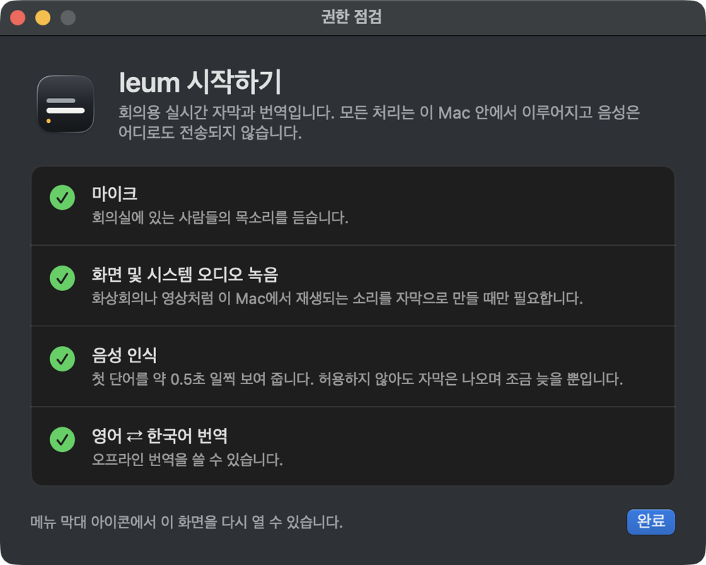
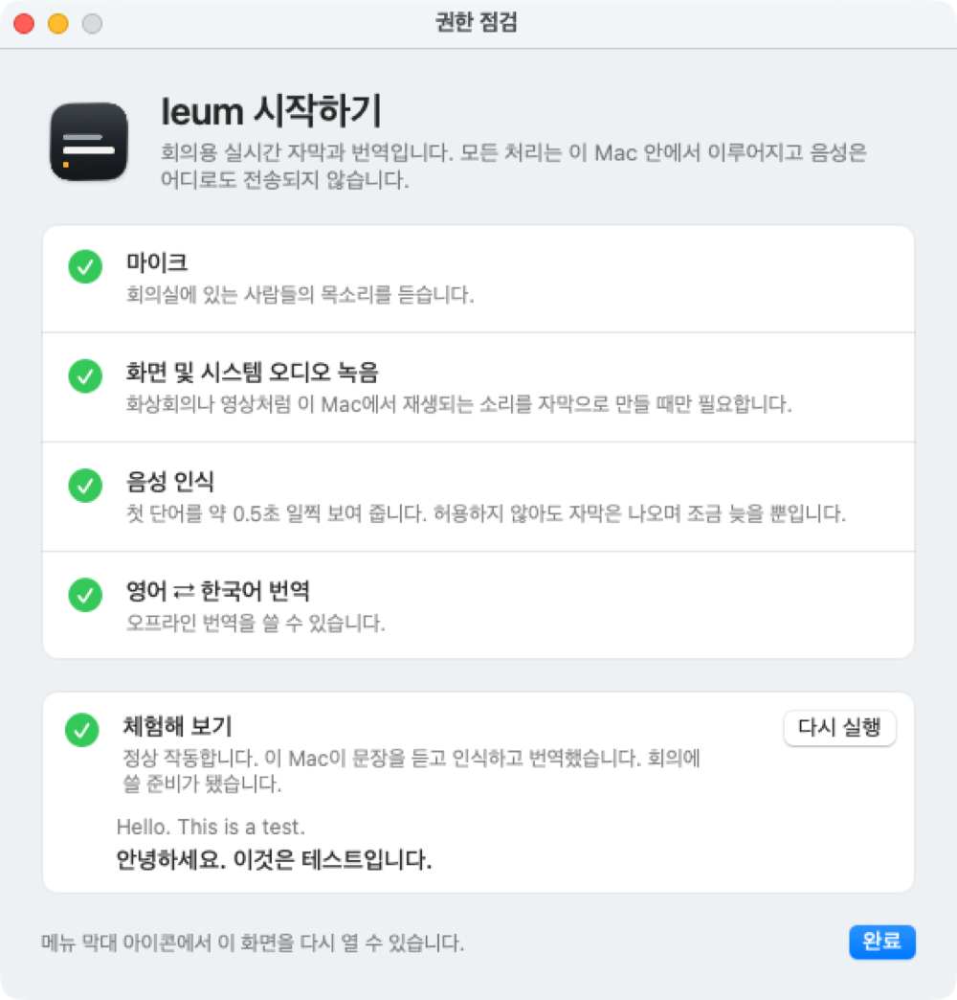
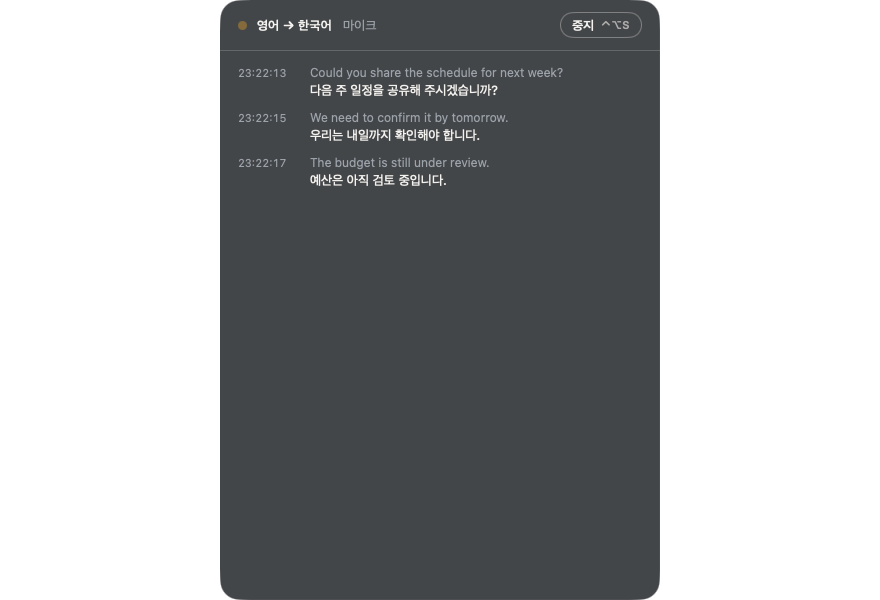
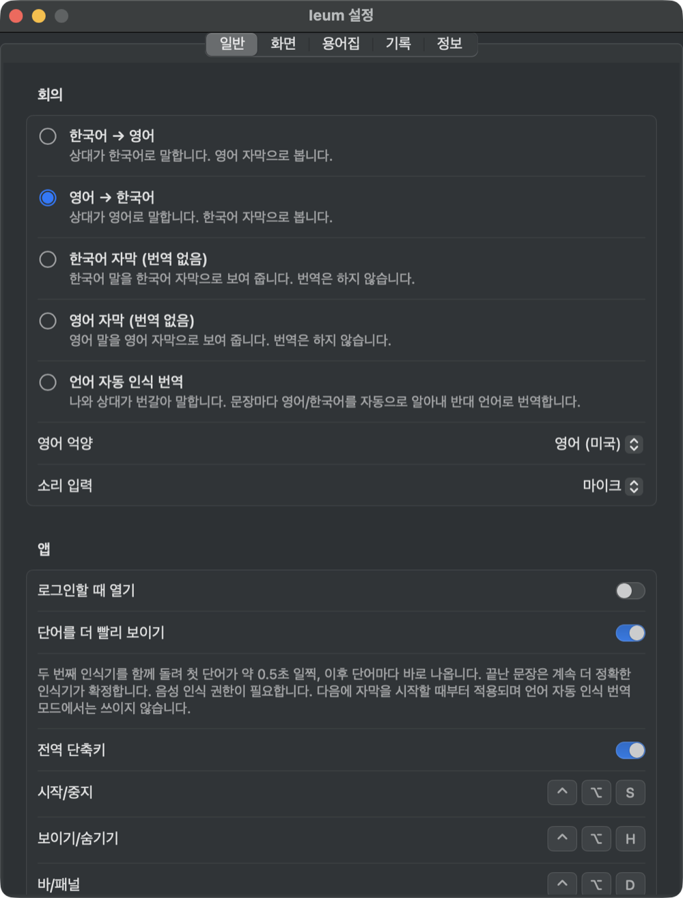
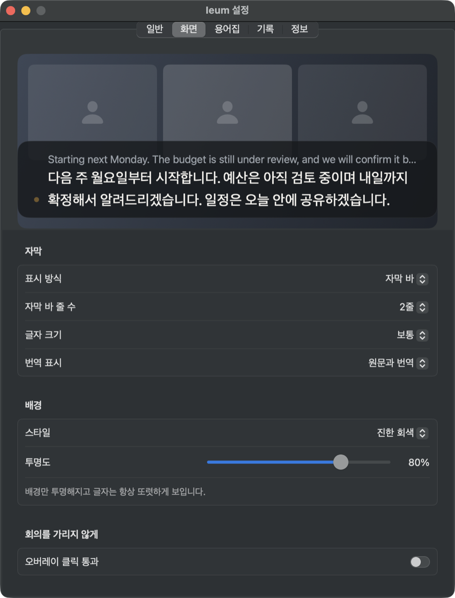
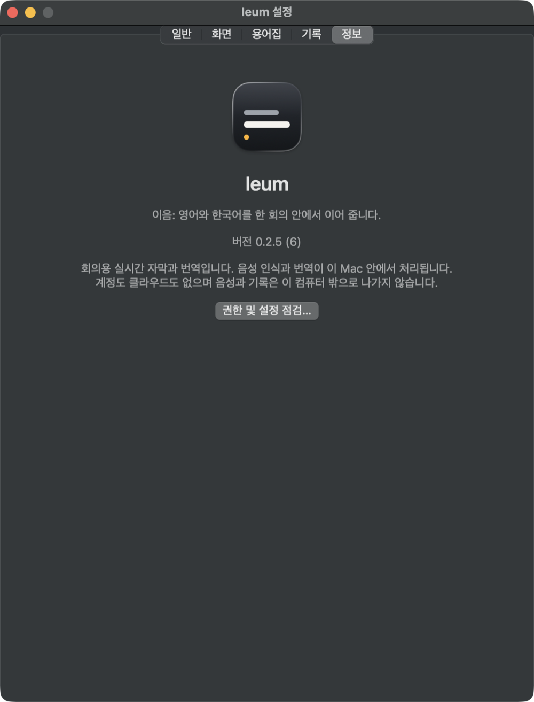
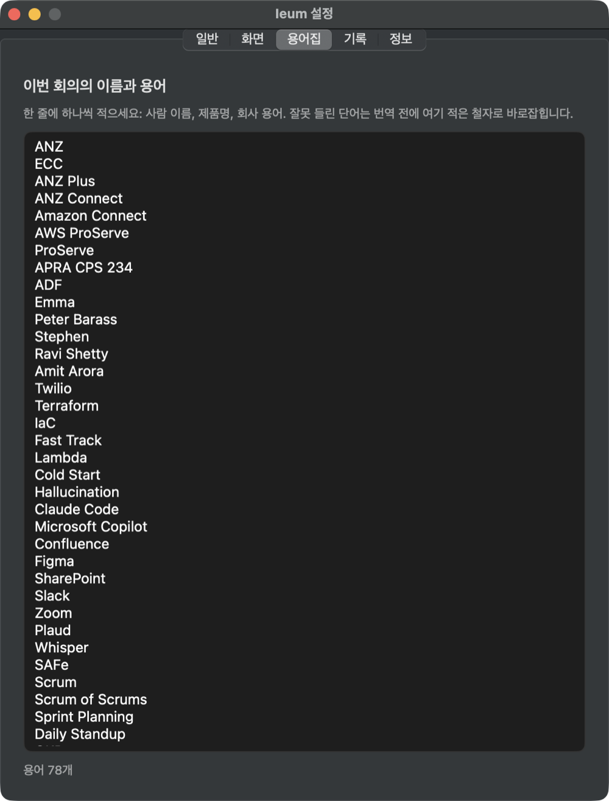

# Ieum (이음) 사용자 가이드

Ieum은 회의 중에 상대의 말을 **자막**으로 보여 주고, 영어 ↔ 한국어로 **번역**해 주는 Mac 앱입니다. 모든 처리는 내 Mac 안에서 이루어지고, 계정이나 인터넷 연결이 필요 없습니다.
(언어 모델을 처음 쓸 때 macOS가 모델을 내려받는 단계만 인터넷이 필요합니다.)


- [1. 설치와 첫 실행](#1-설치와-첫-실행)
- [2. 자막 시작하기](#2-자막-시작하기)
- [3. 회의 모드 고르기](#3-회의-모드-고르기)
- [4. 화면 읽는 법](#4-화면-읽는-법)
- [5. 소리 입력: 마이크와 시스템 소리](#5-소리-입력-마이크와-시스템-소리)
- [6. 설정](#6-설정)
- [7. 회의 용어집](#7-회의-용어집)
- [8. 단축키와 메뉴](#8-단축키와-메뉴)
- [9. 기록 파일](#9-기록-파일)
- [10. 문제 해결](#10-문제-해결)
- [11. 개인정보](#11-개인정보)

## 1. 설치와 첫 실행

**필요한 것**: Apple silicon Mac. 자막은 macOS 14 이상, 빠른 인식과 번역과 자동 인식 모드는 macOS 26.4 이상이 필요합니다.

1. [릴리스 페이지](https://github.com/stoneidev/ieum/releases/latest)(또는 https://ieum.calmwork.today)에서 `Ieum.dmg`를 받습니다.
2. DMG를 열고 **Ieum**을 **Applications**로 끌어다 놓은 뒤 실행합니다. Ieum은 Dock이 아니라 **메뉴 막대**에 나타납니다.
3. 처음 실행하면 **권한 점검** 창이 열립니다.



| 항목 | 필수 여부 | 설명 |
|---|---|---|
| 마이크 | 필수 | 회의실의 목소리를 듣습니다. |
| 화면 및 시스템 오디오 녹음 | 선택 | 화상회의나 영상처럼 **이 Mac에서 재생되는 소리**를 자막으로 만들 때만 필요합니다. |
| 음성 인식 | 선택 | 첫 단어를 약 0.5초 일찍 보여 줍니다. 허용하지 않아도 자막은 나오며 조금 늦을 뿐입니다. |
| 영어 ⇄ 한국어 번역 | 상태 표시 | 오프라인 번역을 쓸 수 있는지 보여 줍니다. 모델이 없으면 설치 방법을 안내합니다. |

권한을 켠 뒤에는 **앱을 완전히 종료했다가 다시 여세요.** 이 창은 메뉴 막대 아이콘이나 설정의 "정보" 탭에서 언제든 다시 열 수 있습니다.

### 체험해 보기 (회의 전에 한 번)

창 아래쪽의 **체험해 보기 → 테스트 실행**을 누르면 짧은 영어 문장을 스피커로 들려주고, 그 소리를 마이크로 듣고 자막과 한국어 번역으로 보여 줍니다(약 15초, 소리가 납니다).
마이크, 음성 인식, 번역이 모두 실제로 동작하는지 회의 전에 확인하는 방법입니다. 현재 설정(회의 모드, 소리 입력)은 바뀌지 않고 기록 파일도 만들어지지 않습니다.



"아무것도 들리지 않았습니다"가 나오면 소리를 키우고 **헤드폰을 벗은 뒤**(마이크가 스피커 소리를 들어야 합니다) 다시 실행하세요.

### 업데이트 후 새로운 기능 안내

Ieum을 업데이트하고 처음 실행하면 **새로운 기능 안내** 창이 한 번 열려, 지난번 이후 달라진 점을 짧은 애니메이션과 함께 보여 줍니다(←/→ 키, Esc로 닫기, "건너뛰기" 가능).
처음 설치한 경우에는 이 창 대신 위의 권한 점검 창이 열립니다.


 다시 보려면 설정 → 정보 → **새로운 기능…**을 누르세요.

## 2. 자막 시작하기

화면 아래에 가로로 긴 **자막 바**가 떠 있습니다. 자막이 꺼져 있을 때는 한 줄이고 시작 버튼이 있습니다.


다음 중 하나로 시작합니다.
- 바의 **자막 시작** 버튼
- 단축키 **⌃⌥S** (Control + Option + S)
- 메뉴 막대 아이콘 → **자막 시작**

멈출 때도 같은 단축키나 버튼(기록 패널에서는 **중지** 버튼)을 씁니다. 멈추면 그 회의의 기록 파일이 닫힙니다.

바는 끌어서 옮기고, 가장자리를 끌어 폭을 바꿀 수 있습니다. 위치와 크기는 기억됩니다. 가리고 싶을 때는 **⌃⌥H**로 숨기고 다시 보입니다.

## 3. 회의 모드 고르기

메뉴 막대 아이콘 → **회의 모드**, 또는 설정 → 일반에서 고릅니다. 실행 중에 바꾸면 자동으로 다시 시작됩니다.

| 모드 | 이럴 때 | 보이는 것 |
|---|---|---|
| **한국어 → 영어** | 상대가 한국어로 말하고 영어로 보고 싶을 때 | 한국어 원문 + 영어 번역 |
| **영어 → 한국어** | 상대가 영어로 말하고 한국어로 보고 싶을 때(가장 흔함) | 영어 원문 + 한국어 번역 |
| **한국어 자막 (번역 없음)** | 한국어 말을 한국어 글자로만 보고 싶을 때 | 한국어만 |
| **영어 자막 (번역 없음)** | 영어 말을 영어 글자로만 보고 싶을 때 | 영어만 |
| **언어 자동 인식 번역** | 나와 상대가 번갈아 말할 때 | 문장마다 영어/한국어를 알아내 반대 언어로 번역 (macOS 26 이상) |

**⌃⌥L**은 방향을 바로 바꿉니다(영어 → 한국어 ↔ 한국어 → 영어, 자막 모드는 한국어 자막 ↔ 영어 자막).
영어를 듣는 모드에서는 설정에서 **영어 억양**(미국/호주)을 고를 수 있습니다.

## 4. 화면 읽는 법

### 자막 바 (기본)

말하는 동안 **말한 언어(원문)는 위쪽 작은 줄**에 단어 단위로 바로 나타나고, **번역은 아래 큰 줄**에 조금 뒤 따라옵니다. 아직 확정되지 않은 단어는 흐리게, 확정되면 또렷하게 바뀝니다.


문장이 끝나면 원문과 번역이 모두 확정됩니다.


번역이 없는 모드는 그 언어의 글자만 나옵니다.


### 기록 패널

⌃⌥D 또는 메뉴 → **자막 바로 전환**으로 바와 패널을 오갑니다. 패널은 지난 문장을 시각과 함께 쌓아 보여 줍니다. 각 문장은 **원문(위, 흐린 글씨)과 번역(아래)** 순서입니다. 글자를 선택해 복사할 수 있습니다.
자막을 중지해도 번역은 그대로 남습니다.



## 5. 소리 입력: 마이크와 시스템 소리

설정 → 일반 → **소리 입력**에서 고릅니다.

- **마이크**: 대면 회의. 노트북을 테이블 중앙에 두고, 말하는 사람에게 가능한 한 가깝게 둘수록 정확합니다.
- **시스템 소리**: Zoom, Meet, 유튜브처럼 **이 Mac에서 재생되는 소리**를 자막으로 만듭니다. "화면 및 시스템 오디오 녹음" 권한이 필요합니다. 디스플레이가 꺼지면 캡처가 끊깁니다.

## 6. 설정

메뉴 막대 아이콘 → **설정…** (⌘,)

### 일반
회의 모드, 영어 억양, 소리 입력, 로그인할 때 열기, **단어를 더 빨리 보이기**(첫 단어가 약 0.5초 일찍 나옵니다. 다음 자막 시작부터 적용되고 자동 인식 모드에서는 쓰이지 않음), 전역 단축키, 화면 언어(시스템/영어/한국어).



### 화면
위쪽 **미리보기**는 지금 설정대로 자막 바가 어떻게 보일지 보여 줍니다. 표시 방식(자막 바/기록 패널), 자막 바 줄 수(1~4), 글자 크기, 번역 표시(원문과 번역/번역만), 배경 스타일과 투명도(**글자는 항상 또렷하고 배경만 투명**해집니다), 오버레이 **자막을 다른 창 위에 항상 표시**(기본 켬. 끄면 자막이 일반 창처럼 다른 창 뒤로 갈 수 있고, ⌃⌥H를 누르면 앞으로 나옵니다), 오버레이 클릭 통과(켜면 자막 아래 창을 그대로 조작할 수 있고, 자막을 옮기려면 끕니다).



### 용어집 · 기록 · 정보
- **용어집**: 이름과 용어를 미리 알려 두는 곳입니다(다음 장).
- **기록**: 저장된 회의 기록의 목록, 열기, Finder에서 보기, 삭제, 저장 폴더 바꾸기.
- **정보**: 버전과 "권한 및 설정 점검" 버튼.



## 7. 회의 용어집

사람 이름, 제품명, 회사 용어는 인식기가 자주 틀립니다. 설정 → **용어집**에 **한 줄에 하나씩** 적어 두면, 잘못 들린 단어가 번역 전에 여기 적은 철자로 바로잡힙니다. 입력을 멈추고 1초 뒤 적용됩니다.



예시:
```
Kubernetes
Siobhan
Trainium
쿠버네티스
```

- 모든 회의에 공통으로 쓰이지 않는 단어 위주로 적으세요. 흔한 단어(PO, Partner 등)는 다른 철자로 바뀔 수 있습니다.
- 회의가 끝나면 목록을 지우거나 다음 회의용으로 바꾸세요.

## 8. 단축키와 메뉴

| 단축키 | 동작 |
|---|---|
| ⌃⌥S | 자막 시작/중지 |
| ⌃⌥H | 자막 숨기기/보이기. "항상 표시"를 끈 상태에서 다른 창이 자막을 가리고 있으면 숨기지 않고 앞으로 가져옵니다 |
| ⌃⌥D | 자막 바 ↔ 기록 패널 |
| ⌃⌥L | 번역 방향 바꾸기 |

설정 → 일반에서 "전역 단축키"를 끌 수 있습니다.

메뉴 막대 아이콘 메뉴(자막 바/패널의 **⋯ 버튼**에도 같은 메뉴가 있습니다): 자막 시작/중지, **회의 모드**, 오버레이 숨기기, 자막 바로 전환, **기록 복사**, 기록 폴더 열기, 권한 및 설정 점검, 설정, 종료. 맨 위 줄에는 현재 상태(자막 꺼짐/듣는 중/문제)가 나옵니다.

## 9. 기록 파일

자막을 시작할 때마다 새 텍스트 파일이 `~/Documents/Ieum Transcripts`(설정에서 바꿀 수 있음)에 만들어지고, 문장이 확정되는 즉시 이어 써집니다. 앱이 갑자기 종료돼도 마지막 문장 외에는 남습니다.

```
# Transcript (en-US) started 2026-11-08 22:35:21
[22:35:32] Could you share the schedule for next week?
[22:35:32] → 다음 주 일정을 공유해 주시겠습니까?
```

- 번역은 `→`로 시작하는 줄입니다. 언어 자동 인식 모드에서는 줄마다 `[EN]`/`[KO]`가 붙습니다.
- **음성은 저장하지 않습니다.** 글자만 저장됩니다.

## 10. 문제 해결

| 증상 | 해결 |
|---|---|
| 권한을 켰는데도 다시 요청한다 | 설정 앱에서 켠 뒤 **Ieum을 완전히 종료하고 다시 여세요.** 그래도 안 되면 목록에서 Ieum을 지웠다가 다시 추가합니다. |
| "시작하는 중…"에서 멈춘다 | 마이크 권한 창이 다른 화면이나 뒤에 떠 있는지 확인하세요. |
| 시스템 소리가 안 나온다 | "화면 및 시스템 오디오 녹음" 권한을 켜고 앱을 다시 여세요. 디스플레이가 꺼져 있으면 캡처가 멈춥니다. |
| 번역이 안 나온다 | 번역은 macOS 26.4 이상이 필요합니다. 처음 쓰는 언어쌍은 모델을 내려받아야 해서 한 번은 인터넷이 필요합니다. 권한 점검 창의 번역 항목을 확인하세요. |
| 첫 단어가 늦게 나온다 | 설정 → 일반 → "단어를 더 빨리 보이기"가 켜져 있고 음성 인식 권한이 허용돼 있어야 합니다. 자동 인식 번역 모드에서는 쓰이지 않습니다. |
| 문장 앞부분이 빠지거나 `…`가 나온다 | 웃음, 박수, 음악, 여러 사람이 동시에 말하는 구간을 인식기가 알아듣지 못한 것입니다. 마이크를 말하는 사람에게 가깝게 두면 줄어듭니다. |
| 이름이 계속 틀리게 나온다 | 설정 → 용어집에 정확한 철자를 적으세요. |
| 메뉴 막대에 Ieum 아이콘이 보이지 않는다 | 메뉴 막대가 가득 차면 macOS가 왼쪽 끝의 아이콘부터 숨깁니다(앱 메뉴가 긴 앱을 쓸 때 특히). 자막 바/패널 오른쪽 끝의 **⋯ 버튼**에 같은 메뉴(시작·중지, 회의 모드, 설정, 종료)가 있습니다. 메뉴 막대 아이콘이 필요하면 다른 아이콘을 ⌘를 누른 채 끌어 내거나 정리하세요. |
| 자막이 화면을 가린다 | ⌃⌥H로 숨기거나, 설정 → 화면에서 "자막을 다른 창 위에 항상 표시"를 꺼서 일반 창처럼 다른 창 뒤로 보내거나, 설정 → 화면에서 줄 수/글자 크기/투명도를 줄이거나 클릭 통과를 켜세요. |
| 자막 바를 옮길 수 없다 | 클릭 통과가 켜져 있습니다. 설정 → 화면에서 끄세요. |

## 11. 개인정보

- 음성 인식과 번역은 모두 Mac 안에서 처리됩니다. 앱은 네트워크 요청을 보내지 않습니다.
- 음성은 어디에도 저장되지 않고, 글자 기록만 위 폴더에 저장됩니다.
- 계정이 없고 분석(텔레메트리)도 없습니다.

문의와 오류 보고는 https://github.com/stoneidev/ieum/issues 로 보내 주세요.
